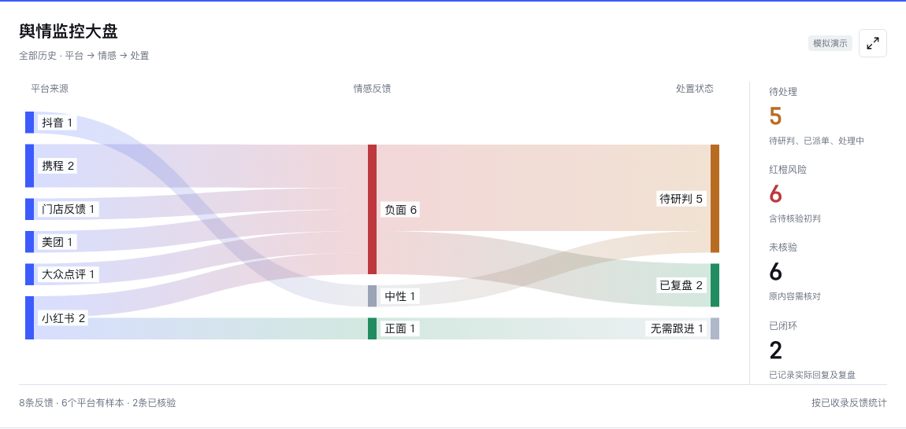

# 旅声 · 酒旅舆情监控与预警系统

张世鑫AI发起的开源酒旅运营工具，面向酒店、民宿、度假区和景区团队。帮助门店把反馈整理成可核验、可跟进、可复盘的工作记录。英文仓库名为 `hospitality-reputation-monitor`，代码采用 MIT 许可证。

**当前为可离线使用的单机工作台，不是全网实时采集服务。** 规则初判与回复模板在本地运行，不调用大模型、不自动联系客人，不承诺已经接入任何平台接口。



[查看完整工作台截图，全部为虚构演示数据](docs/images/workspace-demo.png)

[酒旅业务拆解](docs/产品拆解与日常运营.md) · [贡献指南](CONTRIBUTING.md) · [视觉规范](docs/品牌与视觉.md) · [张世鑫个人网站](https://zhangshixin97.github.io)

打开 `index.html` 即可使用，不需要服务器、账户或安装依赖。GitHub 版本以空白酒店对象启动，真实反馈通过本地文件导入。页面所有依赖均在 `assets/`，支持离线打开。

## 已实现

- 多个监测对象：酒店、民宿、景区，可编辑名称、城市、监测关键词、责任团队和红橙黄处置时限。
- 今日、滚动24小时、近7天、近30天及全部历史统计；反馈发布时间、收录时间和首次发现时间分别保存。
- 平台、风险、状态、核验、内容搜索和待处理筛选；负面预警、咨询、正面反馈独立查看。
- 酒旅风险主题：安全与隐私、卫生、噪音、房型设施、预订退改、服务、交通；景区开放与演艺主题。
- 规则初判、人工纠正、源链接和图像证据核对；城市仅依照用户明确自述产生疑似线索。
- 待研判、已派单、处理中、已回复、已复盘；要求实际回复及复盘记录，操作历史在浏览器中保存。
- 去重、平台覆盖状态、采集过期提示、CSV导出、简报、工作空间备份及恢复。
- 监控大盘：平台、情感与处置状态的流向图，统计卡片和图表可进入对应列表，支持全屏。
- 手工登记反馈、中文CSV列名识别、平台补选及导入前预览；混入其他门店的记录会被拦截。
- 运营复盘：风险主题聚合、负责人、截止时间、整改结果台账；整改记录随备份恢复。
- 本地回复草稿；包含待填写内容的草稿不能直接保存为“已回复”。
- 独立的虚构演示空间，退出后恢复真实工作空间，不将模拟操作写入真实数据。
- 内容或原链接变化后，已记录核验的反馈重新进入待研判；旧导入批次不会回退新的来源时间。

## 同事怎么用

1. 下载或克隆本仓库，打开 `index.html`。
2. 进入“监测对象”，编辑“我的酒店”，或新建民宿、景区。
3. 可先点击“体验示例”了解虚构流程，退出演示后再处理真实数据。在“数据来源”下载CSV模板，从右上角导入；也可以直接“登记反馈”。
4. 在“反馈与预警”核对原链接、选择负责人、记录实际处置；页面刷新后处置保留。
5. 在“运营复盘”把反复出现的问题建为整改事项，记录负责人、期限和真实结果。
6. 换电脑或浏览器前，从右上角导出工作空间备份。新电脑导入备份即可恢复反馈、对象、处置和整改记录。

存储只属于当前浏览器，浏览器清理数据会影响处置记录。同事之间通过备份交接，不支持多人实时同步。文件型浏览器存储支持因浏览器而异；页面会在保存失败时给出明确提示。

JSON备份包含结构化记录，不包含本地图片文件。跨电脑图片需单独授权移交，无法加载时以原链接核对。CSV用于反馈列表交换，人工处置和整改恢复请使用JSON工作空间备份。

## 数据接入范围

| 来源                 | 当前支持方式                        | 自动采集状态     |
| -------------------- | ----------------------------------- | ---------------- |
| 抖音、小红书         | 标准JSON/CSV、已有外部JSONL格式转入 | 未内置持续采集器 |
| 携程、美团、大众点评 | 商家后台授权导出，或逐条核验后整理  | 未接官方接口     |
| 百度地图、高德地图   | 授权数据或公开页面人工核验后导入    | 未接点评接口     |
| 视频号               | 人工导入                            | 保留入口         |
| 门店反馈             | 前厅、客服、现场核实后手工登记      | 不自动收集       |

平台显示“0条”表示没有收录样本，不能用来证明没有投诉。样本负面率不等于全网负面率。内容封面不是评论截图；未人工核验的记录会显示“待核验”。规则分类用于初判，不能自动证明事实。

MediaCrawler 不随本仓库分发，也不由本系统自动执行。现有项目许可为非商业学习许可；将其用于经营监测前，需要取得相应授权或选择授权数据服务。本仓库只提供独立编写的数据格式转换。

## CSV与JSON

CSV使用UTF-8。可使用模板的英文字段，也识别常用中文列名，如“平台、点评内容、评价内容、点评ID、发布时间、点评时间、来源账号、原链接、评分、酒店名称”。未提供平台列时，会在预览中要求选择平台。提供门店名称列时，必须匹配当前对象的名称或监测关键词，防止其他门店的数据混入。发现无效行时整批暂停，修正文件后重试。

建议填写 `sourceId`、`recordKind`、`publishedAt`、`observedAt`、`sourceUrl`。导入前预览新增、合并及未知时间数量，确认后才会保存。

`publishedAt` 是内容发布时间，`observedAt` 是实际采集时间，不是导入时间。时间建议使用 `2026-10-13T09:00:00+08:00`。仅日期的记录保留日期精度，纳入日级范围，排除出滚动24小时及小时图；完全未知发布时间的记录只纳入全部历史。缺失互动量显示 `--`，不会虚构为0。`rating` 为0-5分；不同评分量表需先转换。此工作台的反馈数量不是独立住客人数。

JSON采用：

```json
{
  "records": [
    {
      "platform": "携程",
      "sourceId": "平台点评ID",
      "recordKind": "comment",
      "content": "授权导出的完整点评正文",
      "publishedAt": "2026-10-13T09:00:00+08:00",
      "observedAt": "2026-10-13T09:10:00+08:00",
      "sourceUrl": "https://example.com/review/123",
      "rating": 2,
      "provenance": "商家后台授权导出"
    }
  ]
}
```

数组形式会归属当前所选对象。多个对象请提供 `properties` 数组，并在每条记录注明 `propertyId`；参考 `config.example.json` 的对象字段。相同对象、平台、类型和来源ID会合并，保留最早首次发现和最新收录。没有来源ID时使用内容、时间和链接的稳定组合去重，建议始终提供来源ID。

## Codex协作

在 Codex 中选择本仓库文件夹后，可以使用以下任务说明：

> 请先读 README.md，检查当前监测对象和数据来源。为我们的酒店或民宿整理授权导出或可核验的舆情数据，保留原链接、实际发布时间和采集时间；缺失信息保持未知，未接平台保持未接入。将数据导入本地工作台，检查去重、时间筛选、处置保存和手机布局，最后报告覆盖范围与局限。真实数据、登录状态和账号凭据不得进入Git提交。

日常流程建议为：取得授权反馈数据、导入去重、人工核验红橙风险、派单处置、生成简报、备份交接。后台持续采集、群告警、跨电脑协作需要另行接入服务，目前页面不会在关闭后继续采集。

## 可选本地数据构建

需要 Node.js 18 或更高版本；页面本身不需要 Node.js。

```sh
node scripts/build-data.cjs --config config.local.json --input /absolute/path/feedback.json
```

复制 `config.example.json` 为本地 `config.local.json` 并填写对象。输出到被Git忽略的 `data.local.js`。重复运行会合并现有数据，空数据会停止覆盖。`--replace true` 明确替换，`--allow-empty true` 明确允许清空。

已有JSONL目录可作为 `--input`，目录结构为 `douyin/jsonl/search_contents_YYYY-MM-DD.jsonl`、`search_comments_YYYY-MM-DD.jsonl`，小红书对应 `xhs/jsonl/`。采集日期从文件名读取，并在证据注释中注明；不自动下载远程图片。

## 检查

```sh
npm test
npm run check:release
```

第一项检查分类、日期精度、去重、真实SLA、流转、备份恢复、导入校验和大盘数据守恒。第二项需在Git文件暂存后执行，检查当前发布列表及可达提交历史。`data/`、`private/`、`data.local.js`、登录状态及ZIP均被排除。

有额外隐私标识时，可在被Git忽略的 `private/release-policy.json` 中配置 `{"blockedTerms":["需要保护的项目名"]}`。发布检查会扫描源文件与历史，不把该配置上传。公开截图只使用独立的虚构演示数据。真实数据和备份不应上传到问题反馈、截图或提交中。

`package.json` 中的 `private: true` 只用于防止误发布到 npm，不影响本仓库在 GitHub 公开和采用 MIT 许可证。仓库内的云端测试配置未启用，本地可直接运行以上检查。

## 第三方资源

图标：Lucide，许可证在 `assets/lucide.LICENSE`。CSV解析：Papa Parse 5.7.0，许可证在 `assets/LICENSE`。大盘：Apache ECharts 6.1.0，许可证及NOTICE在 `assets/echarts.LICENSE`、`assets/echarts.NOTICE`。数字字体：JetBrains Mono，许可证在 `assets/fonts/OFL.txt`；中文优先使用本机MiSans，未安装时使用系统字体，不分发MiSans字体文件。真实业务数据和外部平台内容不适用本项目代码许可证。
